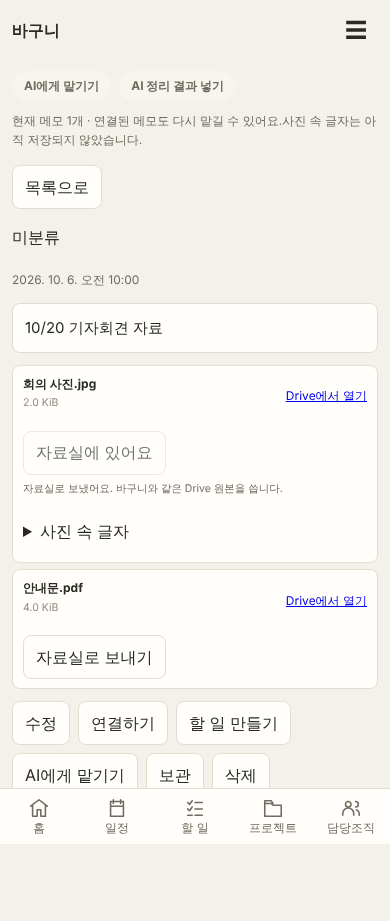
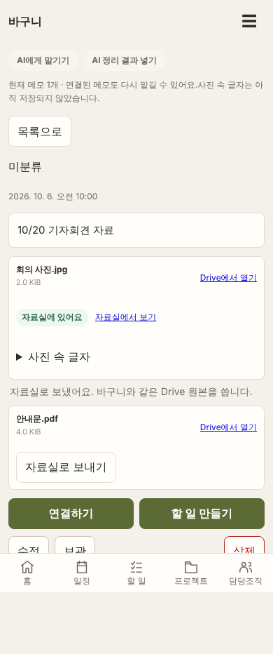
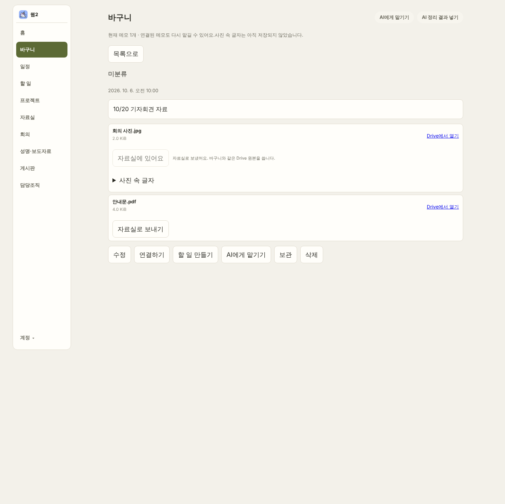
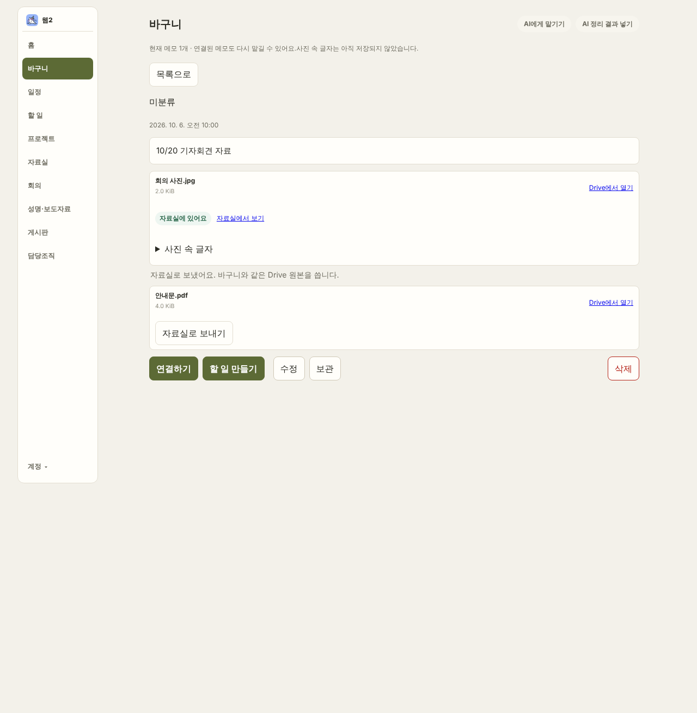

# 📱 폰 가능 — UI-바구니버튼정리 전후 캡처

Claude Code 웹. 시작 main `03553b4`(#547), 브랜치 `claude/basket-button-ui-cleanup-mmx6lh`. 바구니 메모 읽기 화면만 다룬다.

캡처 조건: 로컬 정적 서버, 합성 로그인·API(운영 요청 없음), 첨부 2개 메모에서 첫 첨부를 [자료실로 보내기]한 직후. 변경 전은 `origin/main` `03553b4`, 변경 후는 이 브랜치. 폭 390×844, 1280×900.

| 폭 | 변경 전 | 변경 후 |
| --- | --- | --- |
| 390 |  |  |
| 1280 |  |  |

- '자료실에 있어요'는 버튼이 아닌 배지(`.badge.published`), 결과 불명은 `.badge.review`. 보낸 첨부에는 [자료실에서 보기] 링크.
- 보낸 결과 안내는 첨부 카드 아래 한 줄(14px).
- 동작 버튼: 연결하기·할 일 만들기(`.primary`) / 수정·보관(`.secondary`) / 삭제(`.danger`, 오른쪽 끝). 390은 2줄 정렬, 1280은 1줄.
- 메모 읽기 화면의 'AI에게 맡기기'는 위쪽 도구줄 하나만 남김(아래 버튼과 같은 동작: 현재 메모 1개).
